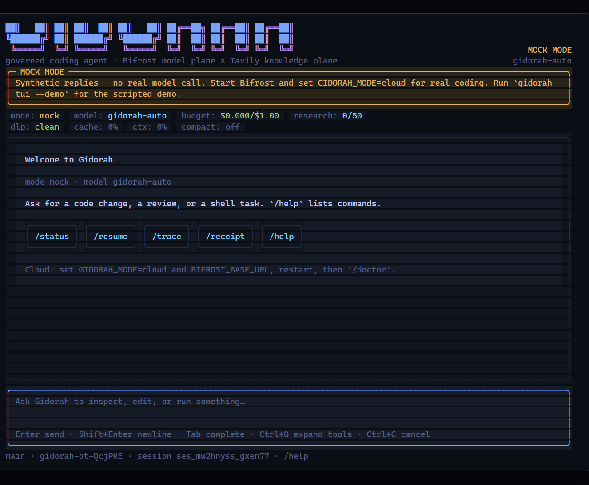
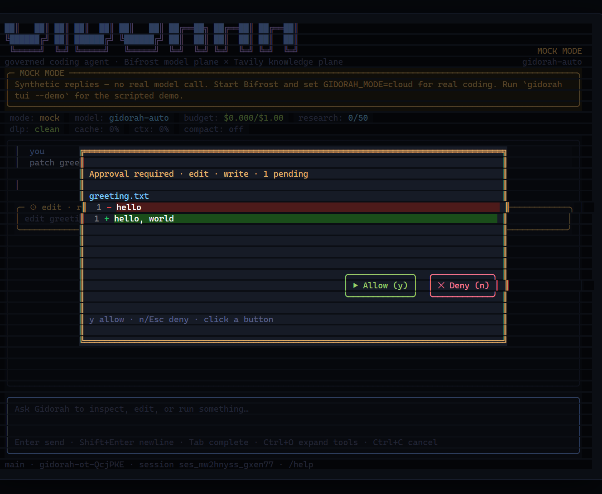
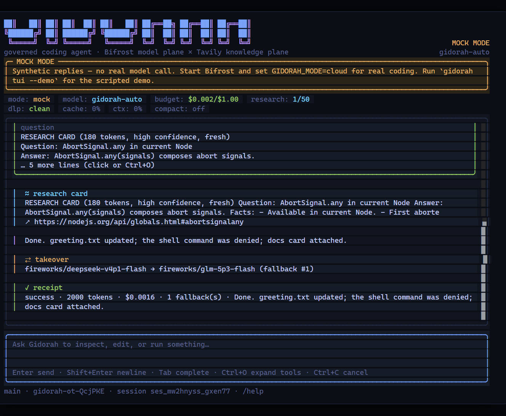
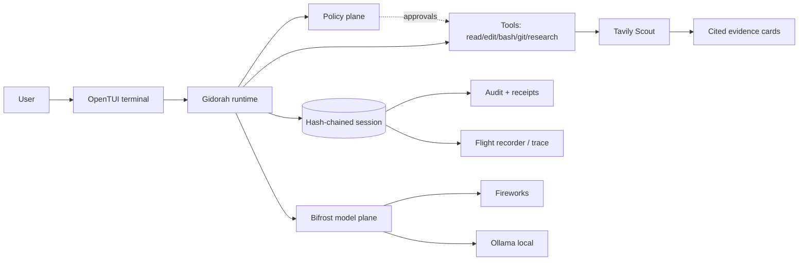

<p align="center">
  <pre>
 ██████╗  ██╗ ██████╗   ██████╗  ██████╗   █████╗  ██╗  ██╗
██╔════╝  ██║ ██╔══██╗ ██╔═══██╗ ██╔══██╗ ██╔══██╗ ██║  ██║
██║  ███╗ ██║ ██║  ██║ ██║   ██║ ██████╔╝ ███████║ ███████║
██║   ██║ ██║ ██║  ██║ ██║   ██║ ██╔══██╗ ██╔══██║ ██╔══██║
╚██████╔╝ ██║ ██████╔╝ ╚██████╔╝ ██║  ██║ ██║  ██║ ██║  ██║
 ╚═════╝  ╚═╝ ╚═════╝   ╚═════╝  ╚═╝  ╚═╝ ╚═╝  ╚═╝ ╚═╝  ╚═╝
  </pre>
  <h1>Gidorah</h1>
  <p><b>The governed coding agent.</b> Less spend. Fewer guesses.</p>
  <p>
    <a href="https://www.npmjs.com/package/gidorah"></a>
    <a href="https://www.npmjs.com/package/gidorah"></a>
    <a href="LICENSE"></a>
    
    <a href="https://github.com/piyushdotcomm/gidorah/actions/workflows/ci.yml"></a>
    <a href="https://github.com/piyushdotcomm/gidorah"></a>
  </p>
<sub>Bifrost model plane · Tavily knowledge plane · OpenTUI terminal · every turn ends with a receipt</sub>
</p>

---

## What this is

Gidorah is a terminal coding agent with a **dual-plane control plane**:

- **Bifrost** is the model plane — the only path to any model. Virtual keys, budgets, routing, fallbacks, logs, and provider keys live there, never in the agent process.
- **Tavily** is the knowledge plane — local-first, version-aware research compressed into cited evidence cards with a credit budget and cache.
- **Gidorah** owns the loop: tools, approvals, context economics, hash-chained audit, flight recorder, and a task receipt.

Most agents ask you to trust a prompt. Gidorah gives you a policy boundary you can inspect.

## Screenshots

<table>
<tr>
<td width="50%">

<p align="center"><sub>Welcome: gradient logo, status pills, clickable command chips</sub></p>
</td>
<td width="50%">

<p align="center"><sub>Approvals: numbered diff, keyboard or mouse buttons, dimmed backdrop</sub></p>
</td>
</tr>
<tr>
<td colspan="2">

<p align="center"><sub>Transcript: research card, model takeover banner, receipt</sub></p>
</td>
</tr>
</table>

> Screenshots are captured from the real OpenTUI renderer in mock mode (the yellow banner is deliberate: no model call is made). Start Bifrost and set `GIDORAH_MODE=cloud` to remove it. More frames: [`apps/tui/DEMO-opentui.md`](apps/tui/DEMO-opentui.md).

## Install

```bash
npm install -g gidorah
gidorah doctor
gidorah tui
```

**Requirements:** Node **>= 26.4** (OpenTUI native renderer). You provide the infrastructure:

1. A **Bifrost gateway** (self-hosted, Apache-2.0) with a Fireworks and/or Ollama provider.
2. A **Bifrost virtual key** created in the local dashboard (`http://127.0.0.1:8080` → Virtual Keys).
3. A **Tavily API key** (not used in confidential mode).

```bash
export GIDORAH_MODE=cloud
export BIFROST_BASE_URL=http://127.0.0.1:8080/openai
export BIFROST_VK_CLOUD=<your-bifrost-virtual-key>
export TAVILY_API_KEY=<your-tavily-key>
export GIDORAH_MODEL_ALIAS=fireworks/accounts/fireworks/models/deepseek-v4p1-flash
gidorah doctor   # checks node, git, policy, mode, gateway
```

No keys are bundled in the package. Runtime data lives in `~/.gidorah` (sessions, traces, audit anchors, history, theme).

### Try it offline

```bash
gidorah tui --demo        # scripted demo, no network
gidorah tui --plain       # line mode for pipes/CI
gidorah demo --replay     # recorded end-to-end demo
```

## Why it feels different

| | Typical agent | Gidorah |
|---|---|---|
| Model access | provider SDK in the agent | **Bifrost only**; provider keys never enter the agent |
| Spend | estimates after the fact | virtual-key budgets, 402 before request, per-task caps |
| Research | web search as a black box | cited cards, credit budget, cache, docs guard |
| Writes/shell | broad permissions | policy classifier + explicit approval, audited |
| Confidential work | “trust us” | local-only key, Tavily disabled, zero external egress policy |
| Audit | logs | SHA-256 hash-chained session, `audit verify`, redacted export |
| Cost/quality | one model | per-phase cascade with fallbacks and takeover banner |

## The terminal

OpenTUI (the same framework opencode uses) provides real Yoga layout, true-colour rendering, mouse support, and a differential renderer — no stale frames.

- **Header:** gradient ASCII logo, branch/session metadata, mode/model badge.
- **Status:** mode, model, budget, research credits, DLP, cache hit rate, context pressure, compaction.
- **Transcript:** Markdown, tool cards (click or `Ctrl+O` to expand), edit diffs with line numbers, research cards, DLP/Docs Guard/takeover/receipt/error cards.
- **Composer:** multiline editor, history, path/slash completion (`Tab`).
- **Approvals:** focus-trapped modal with a diff, `y`/`n`/`Esc`, and **clickable Allow/Deny buttons**.
- **Themes:** `/theme` or `Ctrl+T`; built-ins: `tokyo-night`, `catppuccin-mocha`, `nord`, `gruvbox-dark`, `light`.

| Key | Action |
|---|---|
| `Enter` | send |
| `Shift+Enter` | newline |
| `Tab` | complete slash commands / paths |
| `Ctrl+O` / `Ctrl+E` | expand latest / all tools |
| `Ctrl+T` | theme picker |
| `Ctrl+C` | cancel a turn; twice to exit |
| `Ctrl+D` | quit |
| `PgUp` / `PgDn` | scroll transcript |

Slash commands: `/help /status /model /theme /budget /trace /receipt /new /resume /doctor /quit`.

## How it works



- **Policy below the prompt:** repo classification, virtual-key selection, confidentiality, budgets, and research access are decided by the policy plane. The model cannot change them.
- **Reads are free; writes/shell/git ask.** Denials are honored and audited.
- **Compaction is conditional:** cap tool output first, then compact only when pressure justifies the cache cost.
- **Confidential mode:** local Bifrost key only, Tavily disabled, network shell commands denied.

## Benchmark (honest numbers)

Real Bifrost + real Fireworks models, 12 tasks × 4 arms (A/C/D/F), one run each, full 48/48 solved:

| Arm | Pass | Cost / solved |
|---|---:|---:|
| A always strong | 12/12 | $0.003797 |
| C cascade | 12/12 | $0.001802 |
| D cascade + Tavily | 12/12 | $0.002383 |
| F always cheap | 12/12 | $0.001272 |

- 48 rows, 48 solved, 100%, **$0.002314 per solved task**, $0.111062 total, 0 errored.
- The always-cheap arm is cheapest. Cascade/Tavily are framed as insurance for harder repositories, **not** measured savings; Tavily samples disagree on pass rate.
- Task set is authored over real Node APIs, not a third-party OSS repo; sample size is small. Raw data: [`bench/real_mw0or6tw/`](bench/real_mw0or6tw/).

## Repo map

```text
apps/cli        command entrypoint, doctor, audit, benchmark CLI
apps/tui        OpenTUI terminal (cards, approvals, composer, picker)
packages/core   agent loop, session, context, audit, tools
packages/policy repo classification, approval classifier, shell lexer, budgets
packages/bifrost Bifrost client, mock gateway, DLP twin
packages/tavily Tavily client, Scout, cards, cache, Docs Guard
packages/benchmark task runner, arms, reports
plugins/bifrost-dlp Go plugin bound to the Bifrost SDK
tests           conformance CT-01..CT-40, chaos, replay, CLI contract
docs            product, architecture, engineering, eval, delivery, ADRs
```

## Development

```bash
git clone https://github.com/piyushdotcomm/gidorah.git
cd gidorah
npm ci
npm run build && npm run lint && npm run typecheck && npm test   # 167 tests
node apps/cli/src/main.ts tui
```

Docs: [`docs/`](docs/) · engineering: [`docs/02-engineering`](docs/02-engineering/) · decisions: [`docs/05-decisions`](docs/05-decisions/) · contribution guide: [`CONTRIBUTING.md`](CONTRIBUTING.md) · security: [`SECURITY.md`](SECURITY.md).

## License and attribution

Gidorah is **Apache-2.0**. Bifrost (Maxim AI) is Apache-2.0 and Gidorah is not an official Bifrost product. Tavily is a commercial API used under its terms. OpenTUI and pi-tui are MIT; the DSH TUI is vendored under MIT AND BSD-3-Clause. See [`LICENSE`](LICENSE), [`NOTICE`](NOTICE), and [`third_party/README.md`](third_party/README.md).

<p align="center">
  <b>If Gidorah saves you tokens or a bad afternoon, star the repo.</b><br>
  <a href="https://github.com/piyushdotcomm/gidorah/stargazers">⭐ Star Gidorah</a> · <a href="https://www.npmjs.com/package/gidorah">npm</a>
</p>