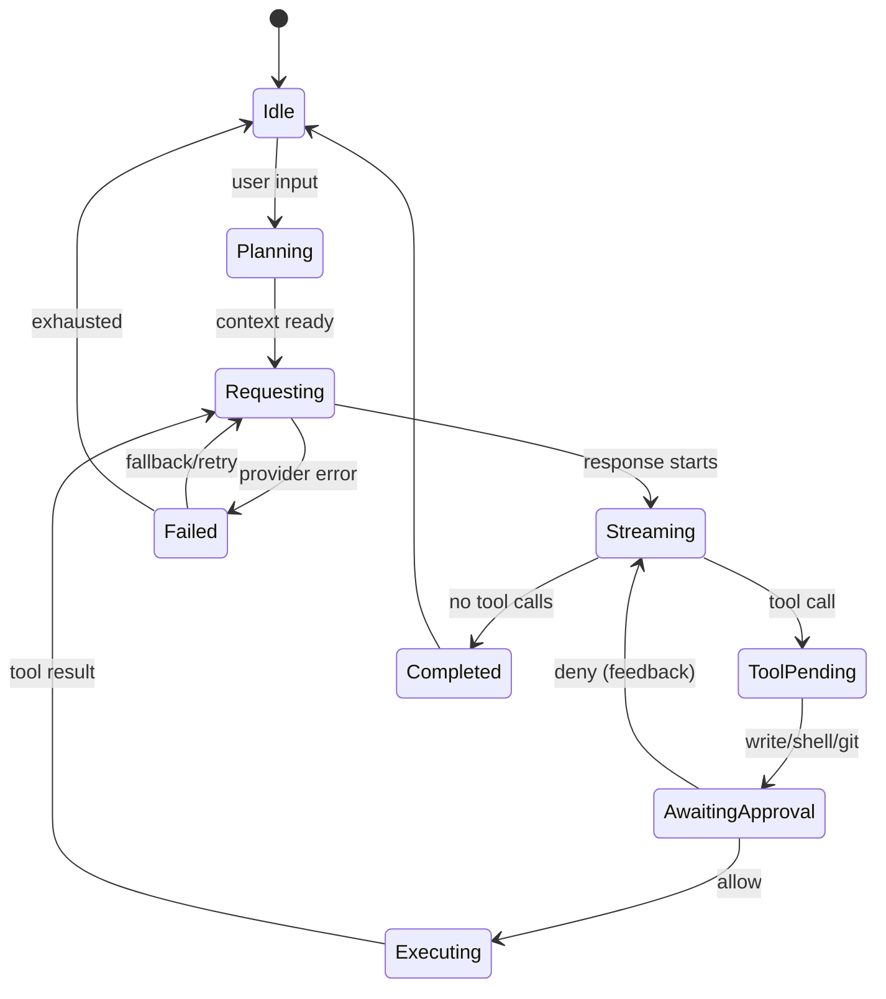

# Agent Runtime

**Status:** Draft · **Owner:** Engineering · **Last updated:** 2026-11-03

---

## 1. Loop model

A **turn** starts when the user submits input and ends when the agent has no more work. A **step** is one model request plus the tool calls it requests. A turn may contain many steps.

```text
turn/start
  claim input
  policy check (repo mode, budget, research allowed)
  build context (stable prefix + history + task state)
  choose phase (explore | edit | verify)
  model request via Bifrost
  stream response
  if tool calls:
    for each call: approval gate -> execute -> result
    continue next step
  else:
    close turn
turn/end
```

### State machine



---

## 2. Tools

| Tool | Class | Approval | Notes |
|---|---|---|---|
| `read` | read | none | Line range or symbol; max bytes; numbered text |
| `repo_map` | read | none | File/symbol outline; no full file bodies |
| `glob` | read | none | Path patterns, respects gitignore |
| `grep` | read | none | Ripgrep-style search, capped matches |
| `list` | read | none | Directory listing |
| `write` | write | ask | Full file create/replace; requires a reason; diff preview |
| `edit` | write | ask | Find/replace patch; minimal output; diff preview |
| `bash` | shell | ask | Exact command + cwd + risk class |
| `git` | git | ask | Read-only subcommands allow; mutations ask |
| `research` | read (external) | none in cloud mode; unavailable in confidential | Tavily Scout; capped and cited |

### Tool contract

Every tool returns:

```ts
interface ToolResult {
  callId: string;
  ok: boolean;
  content: ContentBlock[];   // model-facing, pruned
  artifactPath?: string;     // full output if pruned
  meta?: Record<string, unknown>;
  error?: { code: string; message: string };
}
```

Rules:

- Arguments are validated and frozen before execution.
- Every tool receives an `AbortSignal`.
- Multiple tool calls may be issued in one model step.
- Read-only calls execute in parallel; writes/shell/git execute exclusively in order.
- A batch returns one result per call, in call order; a failure does not cancel sibling reads unless the turn is cancelled.
- Reads are idempotent; writes/shell/git are not.
- A failed tool returns a structured error, not a thrown exception.
- Large outputs are pruned with head/tail and the full output spilled to an artifact.
- Tool results are appended to the session log before the next model request.

### Patch-first editing

- The model emits a **find/replace patch** or unified diff, not a full file body.
- `edit` validates that the search block occurs exactly once; ambiguity fails and asks for a narrower block.
- `write` is reserved for new files, whole-file rewrites with a stated reason, or a patch that cannot express the change.
- Output tokens per edit are recorded; a full-file rewrite is flagged in the trace.
- Evidence: the SWE-Edit 2026 result reports a 17.9% inference-cost reduction and a 2.1% resolved-rate improvement from find-replace edits. Treat it as a hypothesis to reproduce, not a guarantee.

### Repo map and symbol reads

- `repo_map` returns a bounded outline of files and symbols, ranked by relevance to the task.
- `read` accepts a symbol or a line range; full-file reads are allowed but measured.
- Start with a TypeScript/JavaScript symbol extractor; add tree-sitter or `ast-grep` only if the simple extractor is insufficient.
- The map is cached by git commit + file hash; changes invalidate only affected entries.
- Evidence: repository-graph and symbol-index tools report large context reductions; measure on our tasks before claiming a number.

---

## 3. Approval pipeline

```text
tool call
  -> classify (read / write / shell / git)
  -> policy: confidential? network command? protected path?
  -> decision:
       allow  -> execute
       ask    -> approval UI -> allow once | deny
       deny   -> structured denial, no execution
  -> audit event
```

### Classifier rules

**Auto-allow (reads)**
- `read`, `glob`, `grep`, `list`
- `research` (non-confidential only)
- `git status`, `git diff`, `git log`, `git show`, `git branch --show-current`

**Ask**
- `write`, `edit`, `apply_patch`
- Any shell command not on the read-only allowlist
- `git commit`, `git push`, `git reset`, `git checkout`, `git merge`, `git rebase`, `git clean`, `git stash drop`

**Deny**
- Confidential mode: network-capable commands (`curl`, `wget`, `ssh`, `scp`, `nc`, `ncat`, `telnet`, `git push`, `npm publish`, `pip upload`, `docker push`)
- Writes outside the workspace root unless explicitly allowed
- Commands that attempt to read credential stores or environment secrets

**Shell parsing**
- Parse with a real shell lexer, not regex.
- Split on `&&`, `||`, `;`, `|`, subshells, and redirections.
- Every segment must be on the read-only allowlist to auto-allow.
- Unknown flags or dynamic command construction (`$(...)`, backticks) force `ask`.
- `git` aliases and `-c` overrides force `ask`.

**Approval UX**
- Show exact command, cwd, risk class, and a diff for writes.
- Options: `allow once`, `deny`, `allow this exact command for this session` (optional, off by default).
- Denial returns a structured message to the model and is audited.
- No approval prompt for reads; that is a product requirement.

---

## 4. Context manager

### Prompt layout (stable prefix first)

```text
[system: identity + operating rules + policy summary]
[tool schemas: stable order]
[repo map / task state: compact, deterministic]
[conversation history: append-only]
[latest tool results: pruned]
```

Rules:

- No timestamps, request IDs, or live budget numbers in the system prefix.
- Tool schemas do not change within a session unless necessary; changes are logged.
- Dynamic status goes in the TUI and in user-role context, not the cached prefix.
- Model history is derived from the session log; no separate mutable transcript.

### Context economics

The order is deliberate: **cap, then clear, then compact.**

1. **Cap** each tool result before it enters history. A stable cap is cheap and does not rewrite the cached prefix.
2. **Clear** old tool results (replace with a short placeholder, keep the call record) when pressure is high and the result is re-fetchable.
3. **Compact** only at true context pressure (default 90%) or when the benchmark shows it lowers cost per solved task. Summarization rewrites the prefix and can invalidate prompt cache; a smaller context can cost more.

### Pruning

- Default cap per tool result: 4,000 tokens (configurable, stable).
- Head 60% / tail 40%; preserve error lines and stack traces.
- Full output written to `~/.gidorah/artifacts/<session>/<callId>.txt`.
- Model sees a pointer: “Full output: <path> (N lines).”
- The cap is applied before the result is appended to the model-visible history.

### Clearing and compaction

- Clear tool results older than the retained window when context pressure exceeds 70%; keep the `tool/call` record.
- Never clear the most recent tool result or an error needed for the current fix.
- Compact only at 90% pressure or provider-confirmed overflow.
- Preserve: current goal, files touched, decisions, failing tests, open tool pairs, recent 2 turns.
- Replace older history with a structured `task_state` block, not a free-form LLM summary where possible.
- Log compaction as a durable event; never mutate original events.
- Record summary cost, cache-loss cost, and net token reduction. If net cost is negative, disable compaction for the session.

### Cache keys

- Stable prefix hash for provider prompt caching.
- Exact cache key for deterministic sub-calls: `sha256(prompt_version + input_hash)`.
- Research cache key: `sha256(normalized_query + package_version + prompt_version)`.
- Docs fact sheet key: `sha256(package + version + symbol)`.
- Record cache-read/write tokens and prefix-hash changes per request; a short context that breaks cache can be more expensive.

### Per-task budget

- The user/config may set a task cap (e.g., `$0.10`).
- The agent tracks actual spend from Bifrost usage; at the cap it stops or asks to continue.
- The per-user Bifrost budget remains the hard authority; the task cap is an additional guard.
- A task cap never authorizes spend that Bifrost would reject.

---

## 5. Session and resume

- Append-only JSONL at `~/.gidorah/sessions/<id>/session.jsonl`.
- Every event has `seq`, `time`, `type`, `data`, `schemaVersion`.
- `assistant/message` stores usage, provider/model, and a compact stream.
- Open turns are closed with `interrupted` on resume.
- Pending approvals are not re-executed; they are shown as expired and can be re-requested.
- Tool calls without results are marked `unknown` and never auto-retried.
- Session header stores cwd, policy version, and user id.

See [data-and-events.md](data-and-events.md).

---

## 6. Event protocol (core)

| Event | Purpose |
|---|---|
| `turn/start`, `turn/end` | Turn boundaries |
| `step/start`, `step/end` | Model step boundaries |
| `user/message` | User or injected context |
| `system/message` | Rendered system prompt |
| `assistant/message` | Model output + usage + provider info |
| `assistant/attempt` | Failed/retried attempt |
| `tool/call` | Tool request |
| `tool/result` | Tool outcome |
| `approval/request`, `approval/decision` | Human gate |
| `route/changed` | Model takeover notice |
| `budget/updated` | Spend/threshold event |
| `budget/task` | Per-task cap and spend |
| `research/request`, `research/result` | Tavily call and card |
| `docs/check` | Docs Guard verification result |
| `dlp/blocked` | Gateway DLP decision (class/hash only) |
| `compaction/summary` | Context reduction |
| `session/error` | Structured failure |

The TUI, flight recorder, and benchmark are projections of this stream.

---

## 7. Error handling

| Error | Handling |
|---|---|
| 429/5xx | Bifrost retries/fallbacks; if exhausted, structured error; session persists |
| 402 budget | Policy: local fallback or stop |
| Context overflow | Compact, retry once; if still overflow, fail with guidance |
| Tool timeout | Structured timeout; no automatic retry for non-idempotent tools |
| Approval denied | Return denial to model; no execution |
| Tavily 429/5xx | Cache or disable research; continue |
| Invalid model output | One repair attempt with a strict schema; then fail |

---

## 8. Acceptance criteria

- [ ] A turn can complete a real task with read/edit/test/git tools.
- [ ] Reads never prompt; writes/shell/git always prompt unless explicitly allowed.
- [ ] A denied action never executes.
- [ ] A 429/503 produces a visible takeover and a successful continuation.
- [ ] A resumed session preserves transcript, route, budget, and research cards.
- [ ] Pruning preserves errors and writes full output to an artifact.
- [ ] Tool output cap is stable and applied before history; prefix hash is unchanged by caps.
- [ ] Clearing keeps tool-call records and never clears the latest result.
- [ ] Compaction is skipped below 90% pressure; its net cost is recorded and can be disabled.
- [ ] No tool call is replayed after a failover.
- [ ] Per-task budget stops or asks at the cap.
- [ ] Gateway DLP blocks a secret fixture before cloud egress.
- [ ] Docs Guard flags an unknown symbol without blocking tests (when enabled).
- [ ] Edits use find/replace patches by default; full-file rewrites are flagged.
- [ ] `repo_map` returns a bounded outline and symbol reads work.
- [ ] `gidorah audit verify` validates the hash chain and detects a tampered event.
- [ ] `gidorah redteam` reports zero canary egress on the committed corpus.
