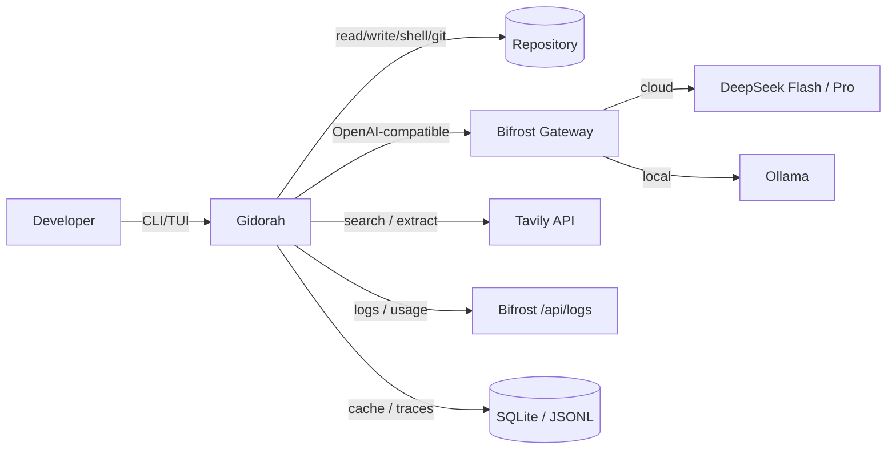
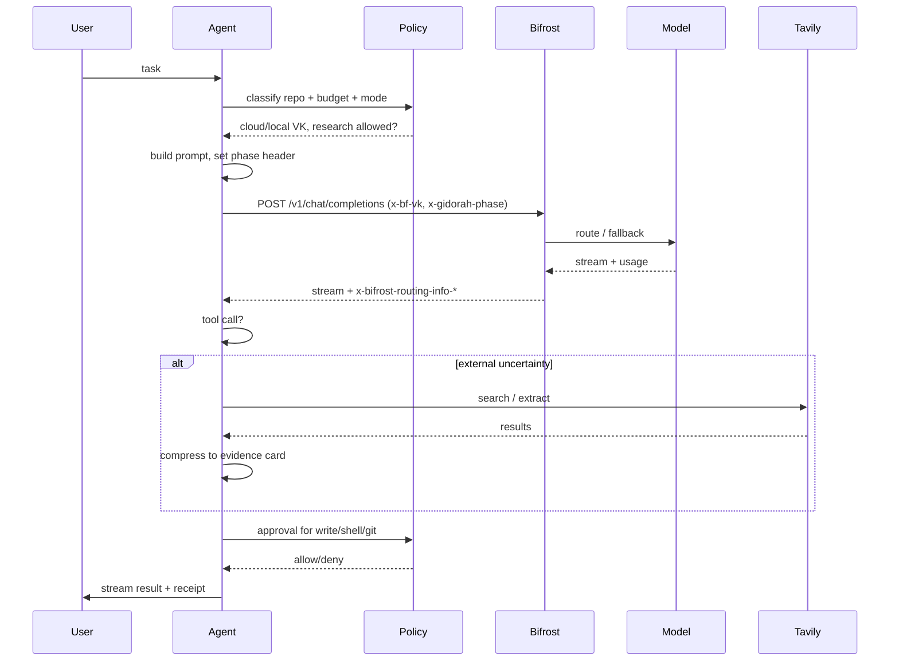

# System Overview

**Status:** Draft · **Owner:** Architecture · **Last updated:** 2026-11-03

---

## 1. Context

Gidorah is a local terminal coding agent. It sits between the developer, the repository, the Bifrost gateway, Tavily, and a local model server.



### Trust boundaries

| Boundary | Trust |
|---|---|
| User ↔ Gidorah | Trusted user; actions still audited |
| Gidorah ↔ Repository | Untrusted content; prompt injection possible |
| Gidorah ↔ Bifrost | Trusted enforcement point; credentials protected |
| Bifrost ↔ Providers | External; untrusted responses |
| Gidorah ↔ Tavily | External; untrusted content |
| Gidorah ↔ Local model | Local execution; still untrusted output |
| TUI ↔ Agent core | Same process; untrusted text is escaped before rendering |

---

## 2. Components

| Component | Responsibility | Key interfaces |
|---|---|---|
| **CLI/TUI** | Input, streaming render, approvals, status, trace | Event bus; approval service |
| **Agent runtime** | Turn/step loop, tool dispatch, cancellation | Tool registry; model client |
| **Repo map** | File/symbol outline for targeted reads | Workspace; git commit |
| **Policy engine** | Repo classification, mode, budgets, research gate, approval classes | Policy file; audit events |
| **Audit chain** | Hash-linked event log, verify, redacted export | Session log; anchor file |
| **Bifrost client** | Request headers, virtual key selection, 402/fallback handling, routing info | OpenAI-compatible HTTP |
| **Bifrost plugin** | Confidential guard, DLP secret scan, policy/audit headers | Bifrost Go plugin hooks |
| **Scout (Tavily)** | Trigger decision, query builder, search/extract, evidence card, cache | Tavily API; SQLite |
| **Docs Guard** | Verify changed external API symbols against cached docs facts | Diff parser; fact sheet; Scout |
| **Context manager** | Prompt assembly, pruning, compaction, task state, cache keys | Session log; token meter |
| **Session store** | Append-only JSONL, resume, export | Filesystem |
| **Ledger** | LLM spend (from Bifrost), research credits, budget status | SQLite; Bifrost logs |
| **Flight recorder** | Per-call trace, receipts, benchmark export | Session events; Bifrost logs |
| **Benchmark runner** | Worktrees, tasks, arms, metrics, report | CLI; logs |
| **Red team** | Injection corpus + canary egress scan | Mock providers; audit chain |
| **Replay/chaos** | Offline demo replay; dependency-kill verification | Recorded traces; process/network harness |

---

## 3. Request lifecycle



### Step rules

1. Policy is resolved **before** the model request.
2. The virtual key is chosen by code, never by the model.
3. Bifrost enforces budget and provider allowlist before forwarding.
4. The Bifrost plugin blocks secrets and enforces confidential routing at the gateway.
5. The response headers determine the takeover notice.
6. Tool calls pass through the approval gate before execution.
7. Tavily is called only after a local-knowledge miss, and only if research is allowed.
8. Docs Guard may verify changed external symbols before tests (stretch).
9. Usage is recorded from provider responses; the ledger reconciles.

---

## 4. Deployment topology (v1)

```text
Developer machine
├─ gidorah CLI/TUI (Node process)
├─ Bifrost gateway (localhost:8080)
├─ Ollama (localhost:11434)
├─ SQLite (budget, research cache, traces)
└─ session JSONL (~/.gidorah/sessions)

External
├─ DeepSeek API (via Bifrost)
└─ Tavily API (only when allowed)
```

- Bifrost is the only path to cloud models.
- Ollama is the only model path in confidential mode.
- Tavily is unreachable in confidential mode by construction (no client call, plus network denial for shell).
- No server or multi-tenant deployment in v1.

---

## 5. Failure modes

| Failure | Behavior |
|---|---|
| Primary provider 429/5xx | Bifrost retries, then fallback; banner; session continues |
| All providers fail | Turn ends with structured error; session persists; user can retry/resume |
| Bifrost down | Agent refuses to send model requests; clear error; no direct-provider fallback |
| Tavily 429/5xx | Use fresh cache; else disable research with notice; continue |
| Ollama down in confidential mode | Stop; never fall back to cloud |
| Budget 402 | Local fallback if allowed; else stop with top-up guidance |
| SQLite locked | Bounded retry; fail closed for budget; research cache miss |
| TUI crash | Session JSONL is durable; resume restores state |
| Prompt injection | Treated as data; policy unchanged; approval gate still applies |

---

## 6. Key design decisions

| Decision | Rationale | ADR |
|---|---|---|
| Bifrost is the model plane | Budgets, fallbacks, routing, cache, logs in one enforcement point | ADR-0001 |
| Tavily is the knowledge plane | External docs/error resolution with compact evidence | ADR-0002 |
| Copy DSH TUI, not the harness | Visual quality without inheriting the monorepo | ADR-0003 |
| Single model egress path | Auditable confidentiality and budget | ADR-0004 |
| TypeScript/Node + event-driven UI | Matches TUI and SDK ecosystem; replaceable renderer | ADR-0005 |
| Policy below the prompt | Prompt injection cannot change provider/budget/mode | ADR-0006 |
| Gateway-enforced DLP | Secrets blocked before cloud egress; defense-in-depth | ADR-0007 |
| Tavily Docs Guard | Proactive API verification before tests | ADR-0008 |
| Cap tool output before compacting | Cache-aware context economics; compaction is conditional | ADR-0009 |
| Bifrost Code Mode read-only arm | Potential token savings without bypassing approvals | ADR-0010 |
| Tamper-evident audit chain | Inspectable evidence for policy/cost/route decisions | ADR-0011 |
| Patch-first edits + repo map | Lower output/input tokens | ADR-0012 |

---

## 7. Non-functional architecture notes

- **Streaming:** the model client streams deltas to the event bus; the TUI renders incrementally.
- **Cancellation:** every request and tool execution receives an `AbortSignal`.
- **Idempotency:** tool calls have stable IDs; failover never replays a completed call.
- **Append-only:** session events are immutable; views are projections.
- **Crash recovery:** an open turn is closed with an `interrupted` marker on resume.
- **Secrets:** API keys live in the OS keychain or environment, never in the session log.
- **Untrusted text:** TUI escapes ANSI/control characters from model, tool, and web content.
- **Observability:** every request carries a session id and a request id for Bifrost log correlation.
- **Replay:** recorded traces reproduce the demo offline; schema drift fails loudly.
- **Chaos:** dependency kills are tested and documented; no silent cloud fallback.
